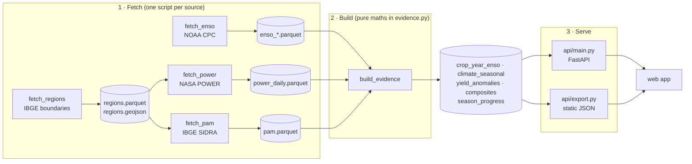

# How Field Phase works: the backend, end to end

A refresher on what happens between "public data on the internet" and "a chart a farmer reads".
No prior knowledge of the code is assumed.

## The idea in one paragraph

El Niño shifts rainfall in Brazil in opposite directions: **too much** in the South (Rio Grande do
Sul), **too little** in the Centre-North (MATOPIBA). We cannot forecast this season's weather day
by day, but we can look at **what happened in past El Niño years** at the same place — the
*analog years* — and compare them with normal years. If strong El Niño years have always meant
40 % more spring rain and 30 % less wheat yield in Tupanciretã, a farmer there can plan for that.
The backend's whole job is to build that comparison honestly, from public data, and to say how
many years each number rests on.

## The pipeline at a glance



Three stages, each with one responsibility:

1. **Fetch** — download raw data and turn it into tidy tables. Nothing is interpreted here.
2. **Build** — all the science: seasons, anomalies, ENSO labels, comparisons.
3. **Serve** — hand the results to the interface as JSON, either live (API) or as files.

Every stage reads and writes **Parquet** files in `data/processed/` (a compact, typed table
format). Each Parquet file also stores *where it came from* in its metadata, so provenance travels
with the data.

## Stage 1 — Fetch

All fetchers share three habits (in `pipeline/common.py`):

- **Cache everything raw.** The exact bytes downloaded go to `data/raw/`. Re-running a script
  reads the cache instead of downloading again; `--refresh` forces a new download. This makes
  runs fast, keeps us polite to the servers, and means the original text behind every number is
  on disk if anyone asks.
- **Check size first.** Before a big download, the script looks up the size and logs it.
- **Fail loudly.** If a source changes its format, the parser raises an error. It never guesses.

### `fetch_regions` — where the farms are

Reads the two pilot municipalities from `config/regions.yaml` and gets each one's **boundary** from
IBGE. From the boundary it computes the **centroid** (the polygon's centre of mass), which is the
point we will ask NASA for weather.

IBGE offers two routes and the script tries both: the *malhas* API (fast, one small file, but it
refuses connections from outside Brazil) and, as a fallback, the official **2025 municipal
shapefile** for the state (about 10 MB). Both give the same centroid within ~20 m.

Output: `regions.parquet` (codes, names, centroid, bounding box) and `regions.geojson`
(simplified outlines, only for drawing the map).

### `fetch_enso` — the state of the Pacific

ENSO (El Niño–Southern Oscillation) is measured by how much warmer or colder than normal the sea
surface is in a box of the equatorial Pacific called **Niño-3.4**.

| What | Meaning | How we get it |
|---|---|---|
| **RONI** | *Relative* Oceanic Niño Index: Niño-3.4 minus the tropical-mean warming, 3-month average. CPC's **official** index since Feb 2026. | plain-text file |
| **ONI** | the older index, without the tropical-mean correction | plain-text file |
| Weekly Niño-3.4 | the latest weekly reading | fixed-width text file |
| Diagnostic Discussion | NOAA's monthly statement: alert status, synopsis | **scraped** from HTML |
| Strength outlook | % chance of each ENSO strength for the next 9 seasons | **scraped** from an HTML table |

Then it classifies every 3-month season with CPC's own rules (`config/enso.yaml`):

- a season is **warm** when RONI ≥ +0.5 °C, **cold** when ≤ −0.5 °C;
- it only counts as an **El Niño / La Niña episode** when that holds for **5 consecutive**
  overlapping seasons. A run still in progress is labelled *provisional*;
- strength: weak ≥ 0.5, moderate ≥ 1.0, strong ≥ 1.5, very strong ≥ 2.0; "historic" ≥ 2.5.

Why "3-month seasons": CPC averages three months (DJF = Dec–Jan–Feb, JFM, …, NDJ) to smooth out
noise. Each season is tied to its middle month.

### `fetch_power` — the weather at each farm

NASA POWER serves daily weather derived from satellite-fed climate models (MERRA-2 for the record,
GEOS-IT for recent days), for any point on Earth, since 1981. We ask for ten variables at each
centroid: rain (`PRECTOTCORR`), temperatures, humidity, wind, sunshine, soil wetness at the surface
and in the root zone, and evapotranspiration.

Two things to know when reading these numbers:

- It is a **grid-cell average** (~50 km wide), not a rain gauge. Good for comparing years at one
  place; not a substitute for a farm's own gauge.
- POWER publishes with a **~3-day lag**. The last few days come back as "missing" and are dropped.

### `fetch_pam` — what the farms harvested

IBGE's *Produção Agrícola Municipal* (PAM) is the official annual survey of every municipality:
planted and harvested area, production, **yield** (kg/ha) and value, per crop, since 1974. We read
it through the SIDRA API:

- **table 1612** — all 44 temporary crops;
- **table 839** — maize split into **1st crop** (summer) and **2nd crop** (*safrinha*), which
  table 1612 merges.

SIDRA uses symbols instead of numbers in some cells: `-` means exactly zero, `...` not available,
`X` withheld for confidentiality. We keep them as a `flag` column rather than turning them into
fake numbers.

### Optional: `fetch_meteomatics` and `fetch_planetary`

Two more fetchers add the future and the view from space: **Meteomatics** forecasts (15 days, 46
days and the seasonal outlook, with all 51 ensemble members) and **Microsoft Planetary Computer**
satellite data (where the cropland is, how green it was each season since 2000, and its slope).
They have their own explainer: [integrations.md](integrations.md).

## Stage 2 — Build (`build_evidence.py` + `evidence.py`)

The arithmetic lives in `pipeline/evidence.py`, which does **no file or network access** — it
only takes tables and returns tables. That is what makes it testable: `tests/test_evidence.py`
checks every function on small hand-made inputs. `build_evidence.py` loads the files, calls those
functions, and saves the results.

### Concept 1 — the crop year

Brazilian summer crops are sown in Sep–Dec and harvested in Jan–Apr, so a calendar year cuts a
season in half. We use a **crop year from July to June, named after the harvest year**:

> crop year **2016** = July 2015 → June 2016 (soy sown in late 2015, harvested in early 2016)

This matches how PAM labels its years. The **season** we analyse is **Sep–Apr** of the crop year,
split into an **early** half (Sep–Dec) and a **late** half (Jan–Apr), because the South's excess
rain peaks early and MATOPIBA's dry spells bite late.

### Concept 2 — giving each crop year an ENSO label

We look at **RONI in NDJ** (Nov–Jan) — the middle of the summer season — and file the crop year
into one of four classes:

| Class | Rule |
|---|---|
| `el_nino_strong` | El Niño episode, strength strong or very strong |
| `el_nino_moderate` | El Niño episode, weak or moderate |
| `neutral` | no episode |
| `la_nina` | La Niña episode |

The **current** crop year (2027) has not reached NDJ yet, so its class comes from CPC's forecast
(100 % chance of El Niño at strong or very strong level for NDJ, issued Nov 2026) and is marked `forecast: true` everywhere. It is never
mixed into the historical evidence.

### Concept 3 — normal, and departures from it (anomalies)

"Normal" is the average of crop years **1991–2020** (the standard 30-year climate baseline). An
**anomaly** is how far a year was from that normal: +40 % rain means 40 % more than the
1991–2020 average for that place and period.

### Concept 4 — rainfall indices (ETCCDI)

Total rain hides what hurts crops, so we also compute three standard indices from the daily data,
defined by the WMO expert team ETCCDI:

| Index | Meaning | Why a farmer cares |
|---|---|---|
| **CDD** | longest run of days with < 1 mm | the *veranico*, a dry spell during the rains |
| **R20mm** | days with ≥ 20 mm | heavy rain: waterlogging, erosion, no machinery in the field |
| **Rx5day** | wettest 5-day total | flood-scale events |

Plus mean root-zone soil wetness and mean maximum temperature over the season. A season is only
computed if **every** day is present; a half-observed season would look like a drought.

### Concept 5 — yield anomalies (detrending)

Yields rise over decades because of better seeds and management. Comparing 1985 with 2020 directly
would mostly measure technology. So for each crop we fit a **straight trend line** through the
yields and measure each year's **% deviation from the trend**. That deviation is mostly weather.

Two safeguards: a series needs **≥ 10 valid years**, and zero yields (crop not planted) are
excluded — not growing a crop is not a crop failure.

**Winter crops** (wheat, oats, canola, barley) need care. They are sown in autumn and harvested in
Sep–Dec of the *same* calendar year, so PAM's wheat **2015** grew through the **2015** El Niño,
whose NDJ belongs to crop year **2016**. `config/crops.yaml` gives each crop a season, and winter
crops are matched to crop year + 1. Without this, El Niño appeared to *help* wheat (+21 %); with it,
the real damage shows (−33 %).

### Concept 6 — composites: the actual evidence

A **composite** is the average anomaly over all years of the same ENSO class, kept with **n** (how
many years) and **the list of years**. For example:

> Tupanciretã, Sep–Dec rain, strong El Niño: **+40 %**, n = 5 (1983, 1992, 1998, 2010, 2016)

We also store the difference from neutral years. Every class appears even when it has no years
(n = 0), so the interface can say "no such years on record" instead of hiding a bar.

### Concept 7 — the season so far (impact preview)

For the current season we accumulate rain day by day from 1 September and compare it, on the same
day of the season, with:

- the **1991–2020 mean** and its **10th–90th percentile range** (what "normal" looks like),
- the **mean of past strong El Niño years** (what this kind of year has looked like).

That is the "impact preview": as of 11 Nov 2026, Tupanciretã has had **624 mm** against a normal
of **448 mm** — already above the 90th percentile — while LEM has had **93 mm** against 169 mm.

## Stage 2b — Rotation scoring (`build_scoring.py` + `scoring.py`)

The evidence feeds the advisor. For every candidate rotation and every ENSO class, three measured
quantities — heavy-rain days on bare soil, transpiration lost to water stress in a daily FAO-56 soil
water balance (SoilGrids soil, FAO-56 roots), and the revenue change in that kind of year — become
0–100 scores, and the farmer's weights combine them.
Full method, sources and results: [scoring.md](scoring.md).

## Stage 3 — Serve

`api/repository.py` turns the tables into JSON **payloads** (contract **v1**). Two ways to deliver
them, same content:

| | Command | When |
|---|---|---|
| Live API | `uv run uvicorn api.main:app --reload` → `/api/v1/...`, docs at `/docs` | development, or if data changes often |
| Static files | `uv run python -m api.export` → `web/public/data/v1/*.json` | hosting the page anywhere with no server |

Endpoints: `/meta` (versions, methods, assumptions), `/enso` (current state, outlook, history),
`/municipalities` (list + map outlines), `/municipalities/{code}` (everything for one place).

Contract rules: numbers are `null` rather than NaN, categories are codes (`el_nino_strong`), never
translated text, and every block says where it came from. Crops with an unsourced assumption carry
`assumption: true`, and the interface shows a warning beside them.

## Configuration: every choice in one place

| File | Holds | Source type |
|---|---|---|
| `config/regions.yaml` | pilot municipalities, season months, baseline, crop-year start | project design |
| `config/enso.yaml` | episode, strength and "historic" thresholds | **CPC's published rules** |
| `config/analysis.yaml` | rain-index thresholds, sub-seasons, NDJ reference, detrending | **ETCCDI**, or marked *project choice* |
| `config/crops.yaml` | SIDRA crop codes, summer/winter season | codes from SIDRA; seasons marked **`suposicao`** until a CONAB calendar is cited |
| `config/sources.yaml` | every data source and how to probe it | verified by `probe_sources` |

## Running and checking it

```bash
uv run python -m pipeline.fetch_regions
uv run python -m pipeline.fetch_enso
uv run python -m pipeline.fetch_power
uv run python -m pipeline.fetch_pam
uv run python -m pipeline.build_evidence
uv run python -m api.export
uv run pytest
```

The whole chain takes about a minute from a cold cache (~37 MB downloaded, two thirds of it the
IBGE state shapefiles) and seconds from a
warm one.

## What to be careful about when presenting

- **Small samples.** LEM's PAM record starts in 2001, so it has only **2** strong El Niño years.
  The interface marks anything below 3 years with a caution. Say "a hint", not "a rule".
- **Grid cells, not gauges.** POWER rain is a ~50 km average.
- **A trend line is a simplification.** It is the standard first pass; Phase 4 will test it.
- **Crop seasons are an assumption** until the CONAB crop calendar is cited (visible in the UI).
- **No rotation scoring yet.** The page shows the evidence the recommendations will use; it does
  not recommend anything yet.
