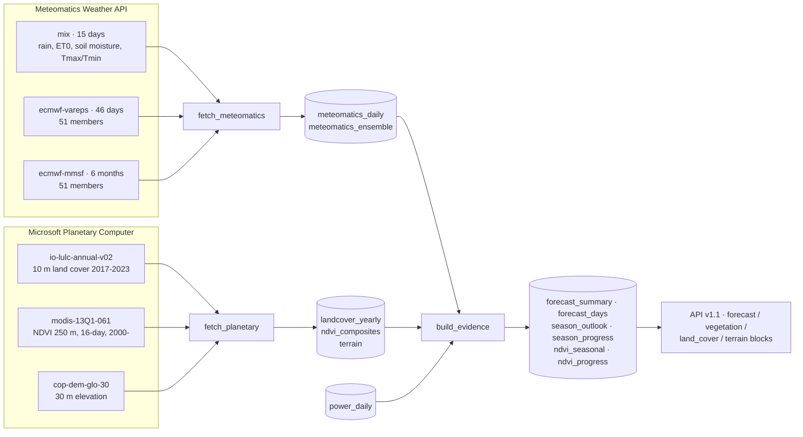

# Meteomatics and Microsoft Planetary Computer

How the two platforms are wired into Field Phase: what each provides, why those datasets and not
others, how the code reaches them, and how the numbers are made. For the rest of the backend see
[how_it_works.md](how_it_works.md).



Both integrations are **optional**. Without them every other part of the pipeline, API and
interface still works; the corresponding payload blocks are `null` and the panels are hidden.

---

## 1. Meteomatics — what happens next

### Why Meteomatics

Everything else in Field Phase looks backwards (what happened in past El Niño years). Meteomatics
adds the forward view: what the weather models expect at this farm over the next two weeks, the
next six weeks, and the rest of the season. That turns the "impact preview" from "years like this
one were wet" into "years like this one were wet, **and the forecast agrees**".

### What we use

Checked against the NASA Space Apps hackathon account on 2026-11-14 (every request below returned
data). The free Basic account has a 10-day forecast and a smaller parameter list; products it
cannot access are reported as unavailable instead of failing.

| Product | Model (`source=`) | Horizon | Parameters | Why |
|---|---|---|---|---|
| Short range | `mix` (Meteomatics' blend) | 15 days | `precip_24h`, `prob_precip_24h`, `t_max_2m_24h`, `t_min_2m_24h`, `evapotranspiration_24h`, `soil_moisture_index_-15cm`, `soil_moisture_index_-50cm` | rain and its chance; heat; crop water demand (reference ET0); how wet the soil is at seed depth and in the root zone |
| Extended | `ecmwf-vareps` | 46 days | `precip_24h`, **51 members** | continues the season curve with an honest range |
| Seasonal | `ecmwf-mmsf` | 6 months | `precip_24h`, **51 members** | month-by-month outlook to the end of the season |

Considered and not used: `most_similar_year` (analog year by temperature and rain; failed with an
upstream error), the Southern Oscillation Index (CPC's RONI is the official ENSO index), growing
degree days (no crop model uses them yet).

**Soil moisture index (SMI):** 0 = permanent wilting point, 1 = field capacity, above 1 = wetter than
the soil can hold (waterlogging). We use it as Meteomatics defines it, with no thresholds of our own.

### How it is wired

```
config/meteomatics.yaml      products, models, parameters, documentation links
pipeline/fetch_meteomatics.py
  build_url()                <start>P<n>D:P1D/<params>/<lat>,<lon>/json?source=<model>[&ens_select=member:0-50]
  fetch_product()            GET + cache in data/raw/meteomatics/<product>_<code>_<YYYYMMDD>.json
  parse_response()           deterministic -> one column per parameter
  parse_ensemble()           ensemble -> long table (date, member, rain)
```

One request per product per municipality: **6 queries per run** for the two pilots. Responses are
cached per UTC day, so running again the same day costs nothing.

**Credentials** never go in the repository. The script tries, in order:

1. the `METEOMATICS_USERNAME` and `METEOMATICS_PASSWORD` environment variables;
2. a `machine api.meteomatics.com login <user> password <pass>` line in `~/.netrc`
   (`%USERPROFILE%\_netrc` on Windows), which `requests` reads automatically;
3. a credential injected by a network proxy (how the Claude Code cloud environment does it).

Meteomatics repeats the account name in every response. The parser drops it before caching, so it
never reaches `data/processed/` or the published JSON.

### Three details that matter for correctness

1. **Interval values are right-aligned.** `precip_24h` stamped `11-10 00:00Z` is the rain of
   **9–10 November**, i.e. calendar day 9 November. Every `*_24h` parameter is shifted back one day
   so a row's date is the day the rain fell, as in NASA POWER. (Without this every comparison is
   off by a day.)
2. **Ensemble models return one member unless asked.** Without `ens_select`, `ecmwf-vareps` and
   `ecmwf-mmsf` return only member 0, the control run — one possible future. That single run
   gave 581 mm for December in Tupanciretã and 4 mm in LEM: plausible-looking and misleading. We
   request **all 51 members**.
3. **Sum first, then summarise.** Monthly and cumulative totals are computed **per member**, and the
   median and 10th–90th percentiles are taken across those 51 totals. Summing daily percentiles
   instead would exaggerate the spread.

### How the numbers are made (`pipeline/evidence.py`)

| Function | Produces |
|---|---|
| `forecast_summary` | 15-day rain total, heavy-rain days (≥20 mm), longest dry run, ET0 total, **water balance = rain − ET0**, SMI at the start and end — next to the NASA POWER **1991–2020 normal for the same calendar dates** (mean, p10, p90) and the strong-El-Niño analog mean |
| `ensemble_progress` | the season-to-date rain curve continued 46 days: each member's own cumulative curve from the last observed day (bridging POWER's ~3-day lag with Meteomatics' analysis of those days), then median and p10–p90 across members |
| `monthly_outlook` | for each complete month of the seasonal forecast: member-median and p10–p90 totals, next to the POWER monthly normal and the strong-El-Niño analog mean |

**Different sources.** The forecast comes from ECMWF/Meteomatics models; the normal comes from NASA
POWER. Models have their own climatology, so "forecast vs normal" mixes two sources. The interface
says so, and the seasonal chart tells the reader to trust the direction (above/below normal), not
the exact number.

### What it shows today (issued 14 Nov 2026)

| | Tupanciretã (RS) | Luís Eduardo Magalhães (BA) |
|---|---|---|
| Rain, next 15 days | **150 mm** vs normal 66 (p90 146) | 110 mm vs normal 119 |
| Soil moisture index, 15 cm | 0.71 → **1.34** (waterlogged) | 0.31 → 0.84 |
| Accumulated rain by 28 Dec (median, 51 members) | **939 mm** (850–1 120) vs normal 677 | 447 mm (368–591) vs normal 523 |
| Seasonal, Dec–Apr | **above** normal every month | **below** normal every month |

The two forecasts reproduce the El Niño dipole the rest of the tool is built on.

---

## 2. Microsoft Planetary Computer — what the land is and how the crops responded

### Why Planetary Computer

It hosts analysis-ready satellite collections as Cloud-Optimised GeoTIFFs behind a public STAC
catalogue. No account is needed, and a program can read **only the pixels over one municipality**
with HTTP range requests, instead of downloading whole scenes. It gives Field Phase three things the
weather data cannot: where the fields actually are, how green the crops were in each season, and
the terrain they sit on.

### What we use (and what we skipped)

The catalogue had 139 collections on 2026-11-14. For Brazilian cropland:

| Collection | What | Used for |
|---|---|---|
| `io-lulc-annual-v02` | Impact Observatory/Esri 10 m land cover, 9 classes, 2017–2023 (CC-BY-4.0) | cropland share per year; the **stable-cropland mask** (pixels that were crops every year) |
| `modis-13Q1-061` | MODIS Terra NDVI, 250 m, 16-day composites, 2000– | how green the crops were in every season since 2000 |
| `cop-dem-glo-30` | Copernicus 30 m DEM | slope → share of cropland in each Embrapa relief class (erosion exposure) |

Relevant but not used yet: `esa-cci-lc` (300 m land cover 1992–2020: a longer agricultural
history, candidate replacement for MapBiomas), `modis-17A2HGF-061` (gross primary productivity),
`modis-15A2H-061` (leaf area index), `modis-11A2-061` (land-surface temperature), `sentinel-2-l2a` /
`hls2-*` (field-scale imagery), `nasa-nex-gddp-cmip6` (climate projections). Not useful here:
`terraclimate` and `gpm-imerg-hhr` stop in 2021; `ecmwf-forecast` overlaps Meteomatics; many
collections are US-only.

Class codes and scale factors were **read from each collection's STAC metadata**, not typed from
memory: Crops = class 5 in io-lulc; NDVI scale 0.0001; MODIS pixel reliability 0 (good) and
1 (marginal) are kept, 2 (snow) and 3 (cloud) are dropped.

### How access works

```
pystac_client.Client.open(STAC)          search: collection + municipality bbox + dates
        │
        ▼  STAC items (one per tile/date), each with asset URLs on *.blob.core.windows.net
planetary_computer.sign(url)             appends a short-lived SAS token (fetched anonymously)
        │
        ▼
rasterio / GDAL  /vsicurl/               HTTP range requests: only the blocks over the window
```

Network hosts this needs (already allowed in the cloud environment): `planetarycomputer.microsoft.com`
(search and tokens), `modiseuwest.blob.core.windows.net` (MODIS), `ai4edataeuwest.blob.core.windows.net`
(land cover), `elevationeuwest.blob.core.windows.net` (DEM).

Install the optional extra first: `uv sync --extra planetary` (pystac-client, planetary-computer,
rasterio — rasterio bundles GDAL, so no system install is needed).

### How the numbers are made

**One grid per municipality.** Everything is computed on the MODIS 250 m sinusoidal grid, snapped to
MODIS's global origin (`modis_grid`). Pixels from different tiles and different dates therefore line
up exactly, and a municipality that straddles two tiles is just two reads pasted together.

**Stable cropland** (`cropland_fraction`, `stable_cropland`). Each year's 10 m land cover is read at
~40 m (decimated), turned into 1 = crops / 0 = other, and **averaged** onto the 250 m grid: each
pixel gets the share of it that is crops. A 250 m pixel is *stable cropland* if that share is ≥ 0.5
in every year 2017–2023. NDVI is then averaged only over those pixels, so forest, towns and land
cleared recently do not dilute the crop signal.

**NDVI per composite** (`read_ndvi`, `ndvi_summary`). For each of ~600 Terra composites since 2000:
read NDVI and pixel reliability, keep usable pixels, average over the municipality and over its
stable cropland, and record what share of the cropland was cloud-free. The build step then:

- drops composites where less than 50 % of the cropland was cloud-free;
- takes the **peak-season (Dec–Mar) mean** per crop year, if at least 4 composites are usable;
- computes anomalies against **2001–2020** (MODIS starts in 2000, so the 1991–2020 baseline is
  impossible — labelled as such, as CLAUDE.md requires for short records);
- builds the same ENSO composites as for rain and yield, and this season's NDVI per 16-day slot vs
  the normal band and the strong-El-Niño years.

**Slope** (`terrain_stats`). Copernicus DEM tiles are mosaicked onto a 1-arc-second lon/lat grid over
the municipality, slope is computed in percent with the east-west pixel size corrected for latitude
(`slope_percent`), and the share of the municipality — and of its stable cropland — in each Embrapa
relief class is recorded.

**Cache.** Raw pixel windows are cached as compressed `.npz` in `data/raw/mpc/` (~220 MB for both
pilots, mostly NDVI). The first run reads ~1,200 MODIS composites (two windows each) and takes a few minutes; later runs
only fetch new composites. `--refresh` re-reads everything; `--skip-ndvi` does land cover and
terrain only (~1.5 minutes).

### Two bugs worth knowing about (both fixed, both tested)

- **Tile edges flattened the slope map.** Copernicus DEM declares no "no-data" value, so pixels of
  the target grid outside a tile came back as **0 m** and won the tile merge: 73 % of the grid was
  flat, median slope 0 %. Each read now declares an explicit fill (`_fill_value`), and a regression
  test guards the merge.
- **The reliability layer is `uint8`**, not `int8` as its STAC entry says; casting is now explicit.

### What it shows today

| | Tupanciretã (RS) | Luís Eduardo Magalhães (BA) |
|---|---|---|
| Cropland share 2017 → 2023 | 71 % → 78 % | 55 % → **67 %** (frontier still expanding) |
| Cropland on rolling ground (≥ 8 % slope) | **35 %** | 0.2 % |
| Median cropland slope | 6.5 % | 0.8 % |
| Peak NDVI, strong El Niño years (n = 2) | −0.5 % | +0.4 % |
| Peak NDVI, La Niña years (n = 13) | **−2.8 %**, with 2012 −18 %, 2022 −24 %, 2023 −18 % | +4.5 % |

**Read honestly:** NDVI does **not** show the El Niño signal at peak season — dense soybean canopies
saturate NDVI, and losses at grain filling do not always show as less green; with n = 2 there is
little to read either way. It **does** show the other side of the dipole: the La Niña droughts that
hit Rio Grande do Sul in 2012, 2022 and 2023 stand out clearly. The terrain result is the strongest
new input for the "protect soil" priority: a third of Tupanciretã's cropland is on rolling ground,
exactly where El Niño's excess rain causes erosion.

---

## Running both

```bash
uv sync --extra planetary
```

```bash
uv run python -m pipeline.fetch_meteomatics
```

```bash
uv run python -m pipeline.fetch_planetary
```

```bash
uv run python -m pipeline.build_evidence
```

```bash
uv run python -m api.export
```

`fetch_meteomatics` needs credentials (see above); `fetch_planetary` needs none. Both need
`regions.parquet`, so run `fetch_regions` first if you have not.
